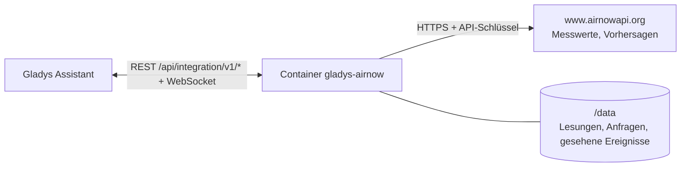
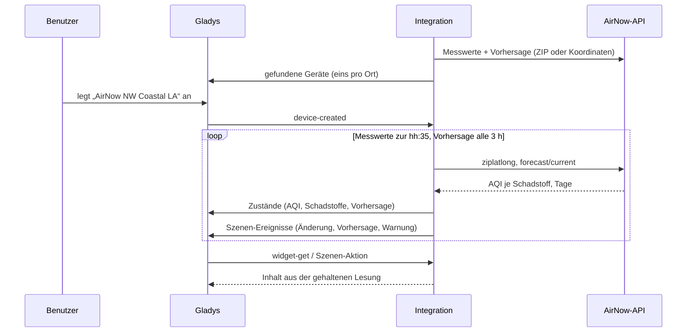
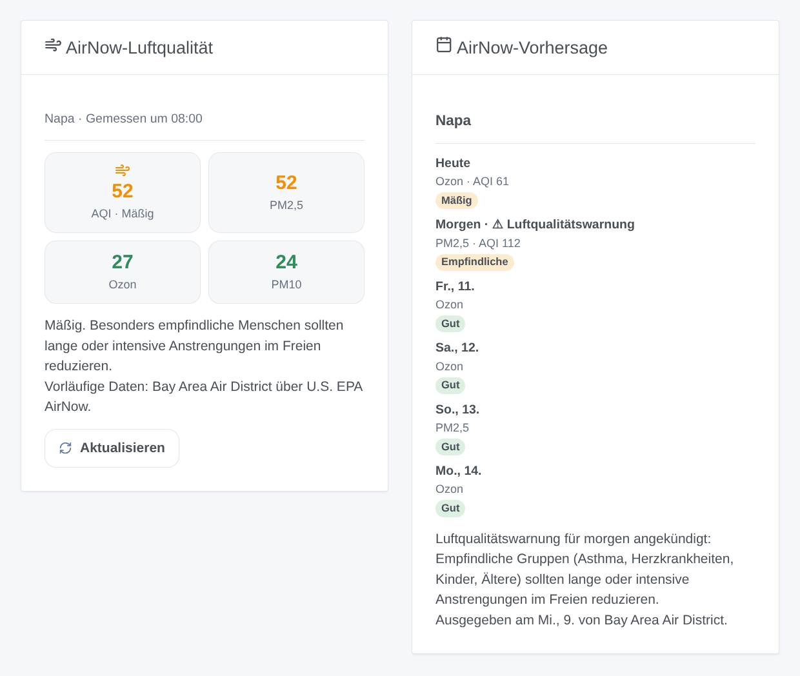

# Gladys AirNow

[English](README.md) · [Français](README.fr.md) · **Deutsch** · [Español](README.es.md)

[](LICENSE)
[](https://github.com/William-De71/gladys-airnow/releases)
[](https://github.com/William-De71/gladys-airnow/actions/workflows/release.yml)
[](https://gladysassistant.com)


Externe Integration für [Gladys Assistant](https://gladysassistant.com) und **[AirNow](https://www.airnow.gov)**, das Luftqualitätsprogramm der US-Umweltbehörde EPA: der aktuelle Luftqualitätsindex und seine Vorhersage für deine Orte, Szenen bei einer Änderung der Luftqualität oder einer Warnung, und Dashboard-Widgets. Sie liest die AirNow-API mit einem kostenlosen Schlüssel.

## Funktionen

- **Ein Gerät pro Ort** (bis zu drei, ein Haus in Gladys oder eine US-Postleitzahl), benannt nach seinem Berichtsgebiet: der aktuelle AQI, der AQI von PM2,5, Ozon und PM10, die Kategorie, der vorhergesagte AQI für heute und morgen, die Vorhersage als Text.
- **3 Szenen-Auslöser**, **1 Szenen-Aktion** und **2 Dashboard-Widgets** (unten).
- Die Dienste 2026 der AirNow-API (die alten wurden am 30.09.2026 abgeschaltet); USA, Kanada und Mexiko.
- Messwerte jeweils zur 35. Minute gelesen, Vorhersagen alle 3 Stunden, in `/data` gehalten; weniger als zwei Anfragen pro Ort und Stunde.
- Konfigurations-Schaltflächen: jetzt lesen, Diagnose.
- Vier Sprachen überall: Englisch, Französisch, Deutsch, Spanisch.

## Funktionsweise




Für jeden Ort fragt die Integration `/aq/observation/current/ziplatlong/` ab (eine Zeile pro in der Nähe gemessenem Schadstoff: sein NowCast-AQI, seine Kategorie, das Berichtsgebiet, die Station, die Stunde) und `/aq/forecast/current/` (eine Zeile pro Schadstoff und Tag: AQI oder nur Kategorie, Aktionstag, Kommentar), mit der ZIP-Postleitzahl oder den Koordinaten des Hauses. Der Gesamt-AQI ist der höchste der Schadstoffe, wie AirNow ihn zeigt. Jede Lesung wird mit der vorigen verglichen, um die Szenen auszulösen.



### Transport

Nur Cloud (`"transports": ["cloud"]`): Der Katalog zeigt das Cloud-Abzeichen. Die Integration kontaktiert `www.airnowapi.org` per HTTPS mit deinem Schlüssel und je Ort der ZIP-Postleitzahl oder den Koordinaten des Hauses (auf etwa 10 m gerundet). Es gibt keine lokale Alternative, also keine Schaltfläche „Lokale Verbindung bevorzugen“.

## Geräte und Funktionen

| Funktion                            | Kategorie / Typ         | Hinweis                           |
| ----------------------------------- | ----------------------- | --------------------------------- |
| Luftqualitätsindex                  | `airquality-sensor/aqi` | höchster der Schadstoffe, 0-999   |
| PM2,5 (AQI), Ozon (AQI), PM10 (AQI) | `airquality-sensor/aqi` | NowCast jedes Schadstoffs         |
| Luftqualität                        | `text/text`             | die Kategorie                     |
| Vorhergesagter AQI heute / morgen   | `airquality-sensor/aqi` | wenn die Behörde eine Zahl angibt |
| Vorhersage                          | `text/text`             | „Morgen: Mäßig (Ozon)“            |

Ein Gerät pro Ort, `should_poll: false`. Ein Wert, den AirNow nicht geliefert hat, wird nicht veröffentlicht: es wird keine 0 erfunden.

## Szenen-Auslöser, Aktionen und Widgets



**Auslöser**

- **Luftqualität geändert**: die aktuelle Kategorie ändert sich. Filter: Ort, neue Kategorie, Richtung (schlechter, besser).
- **Vorhersage aktualisiert**: die vorhergesagte Kategorie eines Tages erscheint oder ändert sich. Filter: Ort, Tag, Kategorie.
- **Luftqualitätswarnung**: eine Vorhersage kündigt einen Air Quality Action Day an. Filter: Ort, Tag.

**Aktion**: Luftqualität eines Orts lesen (AQI, Kategorie, Vorhersage für heute und morgen, Warnung, Satz `summary`).

**Widgets**: **AirNow-Luftqualität** (aktueller AQI und Schadstoffe, Gesundheitshinweis, Behörde) und **AirNow-Vorhersage** (eine Karte pro Tag, Kommentar der Vorhersage, Warnungen).

**Beispiele**

- Wenn **die Luftqualität „Ungesund für empfindliche Gruppen“ oder schlechter wird** → Fenster schließen, Luftreiniger einschalten.
- Wenn **für morgen eine Warnung angekündigt wird** → eine Nachricht an dein Handy senden.
- Jeden Morgen um 7:00 → **Luftqualität lesen** und den `summary` ansagen lassen.

## Voraussetzungen

- Gladys Assistant **5.3.0** oder neuer (Suchbegriffe und Länder des Katalogs, die Hausauswahl). Ältere Instanzen können die Integration nicht installieren.
- Ein kostenloser AirNow-API-Schlüssel: [beantrage ein Konto](https://docs.airnowapi.org/account/request/) und kopiere dann den Schlüssel oben rechts auf der Seite Web Services (siehe [docs/de.md](docs/de.md#einen-api-schlüssel-erhalten)).
- Orte in den USA, in Kanada oder in Mexiko.

## Installation

- **Aus dem Store** von Gladys (Integrationen → Externe Integrationen), mit einem Klick, sobald indiziert.
- **Über die Repository-URL**: `https://github.com/William-De71/gladys-airnow`.
- **Entwicklermodus**: das Image lokal bauen (`docker build -t gladys-airnow .`) und aus Gladys installieren.

## Konfiguration

| Feld                       | Standard    | Rolle                                                         |
| -------------------------- | ----------- | ------------------------------------------------------------- |
| API-Schlüssel              | —           | Der Schlüssel deines AirNow-Kontos (geheim).                  |
| Haus (Ort 1-3)             | —           | Ein Haus in Gladys: sein Standort bestimmt den Ort.           |
| Oder eine ZIP-Postleitzahl | —           | Eine US-Postleitzahl, fünf Ziffern; hat Vorrang vor dem Haus. |
| Sprache der Texte          | automatisch | Gerätenamen und Szenentexte.                                  |

## Verwendung

1. Gib deinen API-Schlüssel und ein bis drei Orte ein (ein Haus oder eine ZIP-Postleitzahl) und speichere.
2. Klicke auf **Jetzt lesen**, um den Schlüssel zu prüfen und den AQI jedes Orts zu sehen.
3. Lege im Tab **Entdecken** die Geräte „AirNow …“ an.
4. Füge die Widgets **AirNow-Luftqualität** und **AirNow-Vorhersage** einem Dashboard hinzu und baue Szenen mit den Auslösern oben.

## Entwicklung

```bash
npm install
npm test                       # node --test, berührt nie das Netzwerk
npm run lint && npm run format:check
npx github:GladysAssistant/integration-store . --skip-image-check
scripts/build-cover.sh         # cover.jpg aus docs/assets/cover.svg
docs/illustrations/render.sh   # docs/assets/widgets.<lang>.png
node .github/scripts/release.mjs next
```

Lokal liest das SDK `GLADYS_HOST_API_URL`, `GLADYS_INTEGRATION_TOKEN` und `GLADYS_INTEGRATION_SELECTOR`; `DEBUG=gladys-integration-sdk` zeigt die Logs des SDK und prüft jeden Widget-Inhalt. Die Tests liefern echte Antworten der AirNow-Dienste 2026 (`test/fixtures/`, aufgezeichnet von den Autoren des R-Pakets [airnow](https://github.com/briandconnelly/airnow), MIT). Die Regeln des Projekts stehen in [CLAUDE.md](CLAUDE.md).

## Release-Prozess


Jeder Merge auf `main` startet die CI und berechnet dann die Version aus den [Conventional Commits](https://www.conventionalcommits.org/) seit dem letzten Tag: `feat` → Minor, `fix` / `perf` → Patch, `!` oder `BREAKING CHANGE` → Major (unter 1.0.0 ein Minor); `docs`, `chore`, `ci`, `test`, `style`, `refactor`, `build` allein veröffentlichen nichts. Der Changelog-Abschnitt wird erzeugt, der Tag gepusht, das Multi-Architektur-Image gebaut, dann erhält `main` den Release-Commit, das GitHub-Release wird erstellt und ein letzter Job prüft das öffentliche Image, den Store-Validator und das Topic.

- Der Titel des Pull Requests wird zum Squash-Commit und dann zur Changelog-Zeile: auf Englisch und für die Nutzer schreiben (`pr-title.yml` prüft ihn). `CHANGELOG.md` nie von Hand bearbeiten.
- 1.0.0 ist eine Entscheidung: Actions → Release → Run workflow mit `release-as: 1.0.0`. `dry-run` zeigt Version und Notizen, ohne zu veröffentlichen.
- **Geschützter Branch**: Das Release pusht seinen Commit mit `GITHUB_TOKEN` auf `main`. Bei einem Ruleset auf `main` GitHub Actions in dessen Bypass-Liste aufnehmen (oder über eine GitHub App pushen), sonst schlägt der Veröffentlichungs-Job mit Hinweisen fehl.
- Nach dem ersten Release das Paket auf `ghcr.io` öffentlich machen (Package settings → Change visibility), sonst kann Gladys es nicht laden.

## Fehlerbehebung

Siehe [docs/de.md](docs/de.md#fehlerbehebung). Probleme bitte mit den Versionen von Gladys und der Integration, dem Ort und den Zeilen der Schaltfläche **Diagnose** melden.

## Mitwirken

Issues und Pull Requests sind willkommen. Vor einem Pull Request `npm run format:check && npm run lint && npm test` ausführen und alle externen IDs und gespeicherten Schlüssel unverändert lassen (siehe [CLAUDE.md](CLAUDE.md)).

## Sicherheit

Siehe [SECURITY.md](SECURITY.md): Sicherheitslücken bitte privat melden. Der API-Schlüssel ist ein `secret`-Feld von Gladys, wird nur per HTTPS an `www.airnowapi.org` gesendet und nie in die Logs geschrieben; die Integration läuft schreibgeschützt mit einem Benutzer ohne root-Rechte in ihrem Container.

## Kommende Bildschirmfotos

Die Bilder oben sind Illustrationen, keine Bildschirmfotos. Echte Bildschirmfotos kommen nach `docs/assets/screenshots/` (PNG, 1280 × 800): `configuration.png`, `discovery.png`, `device.png`, `scene.png`.

## Lizenz

[Apache License 2.0](LICENSE) — siehe auch [NOTICE](NOTICE). Die Luftqualitätsdaten stammen vom AirNow-Programm der US-Umweltbehörde EPA und ihren Partnerbehörden (Bundesstaaten, Kommunen, Stämme), denen sie gehören; sie sind vorläufig und werden unverändert mit ihrer Behörde angezeigt. Diese Integration ist nicht mit der EPA verbunden. Danke an die Dokumentation und das SDK von Gladys, an AirNow und an die Autoren des R-Pakets airnow für die Dokumentation der Dienste 2026.
