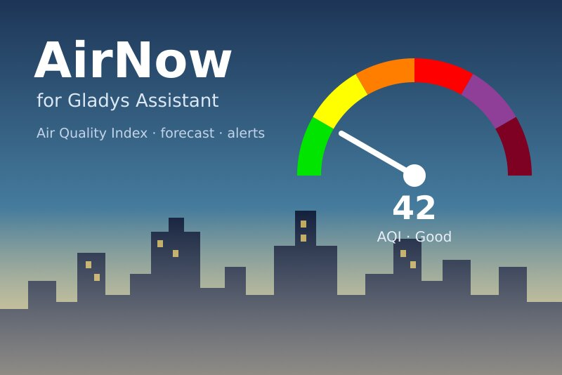
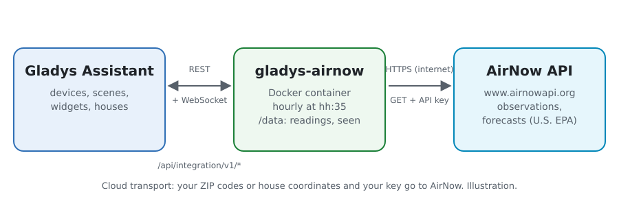
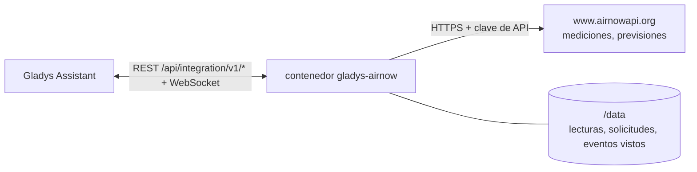
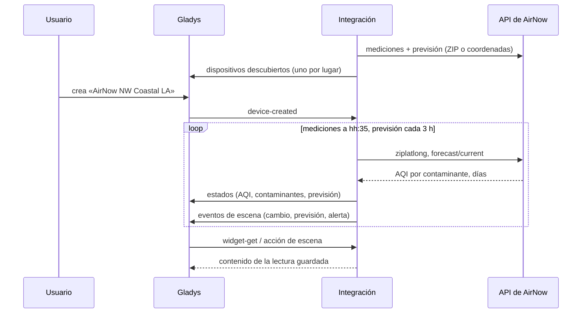
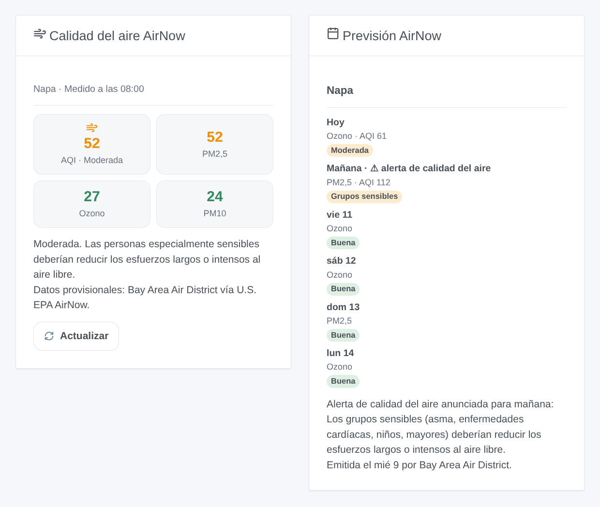

# Gladys AirNow

[English](README.md) · [Français](README.fr.md) · [Deutsch](README.de.md) · **Español**

[](LICENSE)
[](https://github.com/William-De71/gladys-airnow/releases)
[](https://github.com/William-De71/gladys-airnow/actions/workflows/release.yml)
[](https://gladysassistant.com)



Integración externa de [Gladys Assistant](https://gladysassistant.com) para **[AirNow](https://www.airnow.gov)**, el programa de calidad del aire de la EPA de EE. UU.: el índice de calidad del aire actual y su previsión para sus lugares, escenas cuando cambia la calidad del aire o se anuncia una alerta, y widgets de panel. Lee la API de AirNow con una clave gratuita.

## Funcionalidades

- **Un dispositivo por lugar** (hasta tres, una casa de Gladys o un código ZIP de EE. UU.), con el nombre de su zona de medición: el AQI actual, el AQI de PM2,5, ozono y PM10, la categoría, el AQI previsto hoy y mañana, la previsión en texto.
- **3 disparadores de escena**, **1 acción de escena** y **2 widgets** de panel (más abajo).
- Los servicios 2026 de la API de AirNow (los antiguos se retiraron el 30/09/2026); Estados Unidos, Canadá y México.
- Mediciones leídas en el minuto 35 de cada hora, previsiones cada 3 horas, guardadas en `/data`; menos de dos solicitudes por lugar y por hora.
- Botones de configuración: leer ahora, diagnóstico.
- Cuatro idiomas en todas partes: inglés, francés, alemán, español.

## Cómo funciona





Para cada lugar, la integración consulta `/aq/observation/current/ziplatlong/` (una fila por contaminante medido cerca del lugar: su AQI NowCast, su categoría, la zona de medición, la estación, la hora) y `/aq/forecast/current/` (una fila por contaminante y por día: AQI o solo categoría, día de acción, comentario), con el código ZIP o las coordenadas de la casa. El AQI global es el más alto de los contaminantes, como lo muestra AirNow. Cada lectura se compara con la anterior para disparar las escenas.



### Transporte

Solo nube (`"transports": ["cloud"]`): el catálogo muestra la insignia de nube. La integración contacta `www.airnowapi.org` por HTTPS con su clave y, por lugar, el código ZIP o las coordenadas de la casa (redondeadas a unos 10 m). No hay alternativa local, así que no hay botón «Preferir la conexión local».

## Dispositivos y funcionalidades

| Funcionalidad                        | Categoría / tipo        | Nota                                    |
| ------------------------------------ | ----------------------- | --------------------------------------- |
| Índice de calidad del aire           | `airquality-sensor/aqi` | el más alto de los contaminantes, 0-999 |
| PM2,5 (AQI), Ozono (AQI), PM10 (AQI) | `airquality-sensor/aqi` | NowCast de cada contaminante            |
| Calidad del aire                     | `text/text`             | la categoría                            |
| AQI previsto hoy / mañana            | `airquality-sensor/aqi` | cuando la agencia da un número          |
| Previsión                            | `text/text`             | «Mañana: Moderada (Ozono)»              |

Un dispositivo por lugar, `should_poll: false`. Un valor que AirNow no dio no se publica: no se inventa ningún 0.

## Disparadores, acciones de escena y widgets



**Disparadores**

- **Cambio de calidad del aire**: la categoría actual cambia. Filtros: lugar, nueva categoría, sentido (empeora, mejora).
- **Previsión actualizada**: la categoría prevista de un día aparece o cambia. Filtros: lugar, día, categoría.
- **Alerta de calidad del aire**: una previsión anuncia un Air Quality Action Day. Filtros: lugar, día.

**Acción**: leer la calidad del aire de un lugar (AQI, categoría, previsión de hoy y mañana, alerta, frase `summary`).

**Widgets**: **Calidad del aire AirNow** (AQI y contaminantes actuales, consejo de salud, agencia) y **Previsión AirNow** (una tarjeta por día, comentario del pronosticador, alertas).

**Ejemplos**

- Cuando **la calidad del aire pasa a Dañina para grupos sensibles o peor** → cerrar las ventanas, encender el purificador.
- Cuando **se anuncia una alerta para mañana** → enviar un mensaje a su teléfono.
- Cada mañana a las 7:00 → **leer la calidad del aire** y anunciar el `summary`.

## Requisitos

- Gladys Assistant **5.3.0** o posterior (palabras clave y países del catálogo, el selector de casa). Las instancias más antiguas no pueden instalar la integración.
- Una clave de API de AirNow gratuita: [solicite una cuenta](https://docs.airnowapi.org/account/request/) y copie la clave que aparece arriba a la derecha de la página Web Services (vea [docs/es.md](docs/es.md#obtener-una-clave-de-api)).
- Lugares en Estados Unidos, Canadá o México.

## Instalación

- **Desde la tienda** de Gladys (Integraciones → Integraciones externas), con un clic, una vez indexada.
- **Desde la URL del repositorio**: `https://github.com/William-De71/gladys-airnow`.
- **Modo desarrollador**: construya la imagen en local (`docker build -t gladys-airnow .`) e instálela desde Gladys.

## Configuración

| Campo                | Por defecto | Función                                                              |
| -------------------- | ----------- | -------------------------------------------------------------------- |
| Clave de API         | —           | La clave de su cuenta de AirNow (secreto).                           |
| Casa (lugar 1-3)     | —           | Una casa de Gladys: su ubicación sitúa el lugar.                     |
| O un código ZIP      | —           | Un código postal de EE. UU., cinco dígitos; prevalece sobre la casa. |
| Idioma de los textos | automático  | Nombres de los dispositivos y textos de las escenas.                 |

## Uso

1. Introduzca su clave de API y de uno a tres lugares (una casa o un código ZIP) y guarde.
2. Haga clic en **Leer ahora** para comprobar la clave y ver el AQI de cada lugar.
3. En la pestaña **Descubrir**, cree los dispositivos «AirNow …».
4. Añada los widgets **Calidad del aire AirNow** y **Previsión AirNow** a un panel, y cree escenas con los disparadores de arriba.

## Desarrollo

```bash
npm install
npm test                       # node --test, nunca toca la red
npm run lint && npm run format:check
npx github:GladysAssistant/integration-store . --skip-image-check
scripts/build-cover.sh         # cover.jpg desde docs/assets/cover.svg
docs/illustrations/render.sh   # docs/assets/widgets.<lang>.png
node .github/scripts/release.mjs next
```

En local, el SDK lee `GLADYS_HOST_API_URL`, `GLADYS_INTEGRATION_TOKEN` y `GLADYS_INTEGRATION_SELECTOR`; `DEBUG=gladys-integration-sdk` muestra los registros del SDK y comprueba cada contenido de widget. Las pruebas sirven respuestas reales de los servicios AirNow 2026 (`test/fixtures/`, capturadas por los autores del paquete R [airnow](https://github.com/briandconnelly/airnow), MIT). Las reglas del proyecto están en [CLAUDE.md](CLAUDE.md).

## Proceso de publicación


Cada fusión en `main` lanza la CI y calcula la versión a partir de los [Conventional Commits](https://www.conventionalcommits.org/) desde la última etiqueta: `feat` → menor, `fix` / `perf` → parche, `!` o `BREAKING CHANGE` → mayor (una menor por debajo de 1.0.0); `docs`, `chore`, `ci`, `test`, `style`, `refactor`, `build` solos no publican nada. Se genera la sección del changelog, se sube la etiqueta, se construye la imagen multiarquitectura, después `main` recibe el commit de publicación, se crea la GitHub Release y un último job comprueba la imagen pública, el validador de la tienda y el topic.

- El título de la pull request se convierte en el commit squash y luego en la línea del changelog: escríbalo en inglés, para el usuario (`pr-title.yml` lo comprueba). No edite nunca `CHANGELOG.md` a mano.
- 1.0.0 es una decisión: Actions → Release → Run workflow con `release-as: 1.0.0`. `dry-run` muestra la versión y las notas sin publicar nada.
- **Rama protegida**: la publicación sube su commit a `main` con `GITHUB_TOKEN`. Con un ruleset en `main`, añada GitHub Actions a su lista de excepciones (o suba mediante una GitHub App); si no, el job de publicación falla con instrucciones.
- Tras la primera publicación, haga público el paquete de `ghcr.io` (Package settings → Change visibility); si no, Gladys no puede descargarlo.

## Solución de problemas

Vea [docs/es.md](docs/es.md#solución-de-problemas). Informe de los problemas con las versiones de Gladys y de la integración, el lugar, y las líneas del botón **Diagnóstico**.

## Contribuir

Las incidencias y pull requests son bienvenidas. Ejecute `npm run format:check && npm run lint && npm test` antes de abrir una pull request, y mantenga sin cambios todos los identificadores externos y claves guardadas (vea [CLAUDE.md](CLAUDE.md)).

## Seguridad

Vea [SECURITY.md](SECURITY.md): informe de las vulnerabilidades en privado. La clave de API es un campo `secret` de Gladys, enviada solo a `www.airnowapi.org` por HTTPS y nunca escrita en los registros; la integración se ejecuta en solo lectura, con un usuario sin privilegios de root, en su contenedor.

## Capturas pendientes

Las imágenes de arriba son ilustraciones, no capturas de pantalla. Las capturas reales irán en `docs/assets/screenshots/` (PNG, 1280 × 800): `configuration.png`, `discovery.png`, `device.png`, `scene.png`.

## Licencia

[Licencia Apache 2.0](LICENSE) — vea también [NOTICE](NOTICE). Los datos de calidad del aire proceden del programa AirNow de la EPA de EE. UU. y de sus agencias asociadas (estatales, locales, tribales), que son sus propietarias; son provisionales y se muestran tal como se reciben, con su agencia. Esta integración no está afiliada a la EPA. Gracias a la documentación y al SDK de Gladys, a AirNow y a los autores del paquete R airnow por documentar los servicios 2026.
