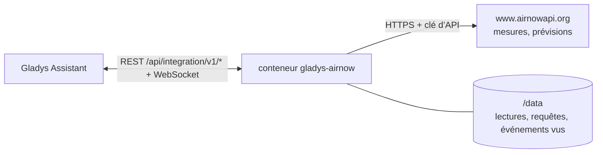
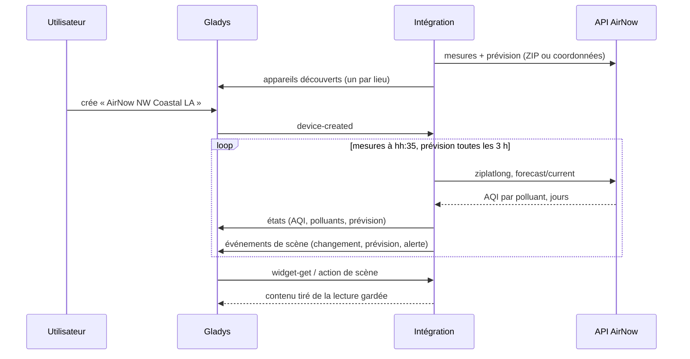
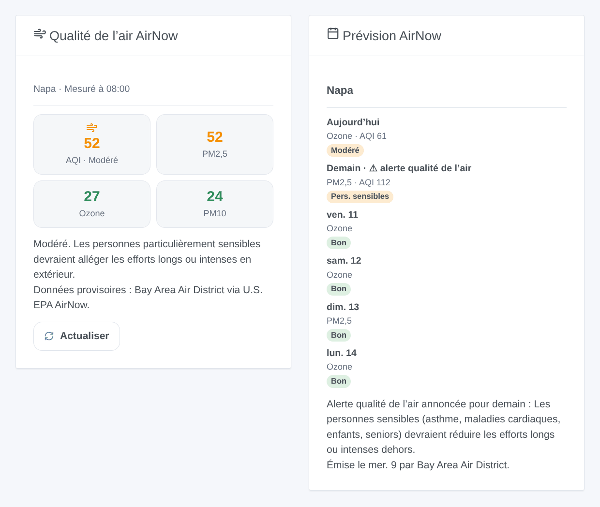

# Gladys AirNow

[English](README.md) · **Français** · [Deutsch](README.de.md) · [Español](README.es.md)

[](LICENSE)
[](https://github.com/William-De71/gladys-airnow/releases)
[](https://github.com/William-De71/gladys-airnow/actions/workflows/release.yml)
[](https://gladysassistant.com)


Intégration externe [Gladys Assistant](https://gladysassistant.com) pour **[AirNow](https://www.airnow.gov)**, le programme de qualité de l’air de l’EPA américaine : l’indice de qualité de l’air actuel et sa prévision pour vos lieux, des scènes quand la qualité de l’air change ou qu’une alerte est annoncée, et des widgets. Elle lit l’API AirNow avec une clé gratuite.

## Fonctionnalités

- **Un appareil par lieu** (jusqu’à trois, une maison de Gladys ou un code ZIP américain), nommé d’après sa zone de mesure : l’AQI actuel, l’AQI de PM2,5, ozone et PM10, la catégorie, l’AQI prévu aujourd’hui et demain, la prévision en texte.
- **3 déclencheurs de scène**, **1 action de scène** et **2 widgets** de tableau de bord (ci-dessous).
- Les services 2026 de l’API AirNow (les anciens ont été retirés le 30/09/2026) ; États-Unis, Canada et Mexique.
- Mesures lues à la 35e minute de chaque heure, prévisions toutes les 3 heures, gardées dans `/data` ; moins de deux requêtes par lieu et par heure.
- Boutons de configuration : lire maintenant, diagnostic.
- Quatre langues partout : anglais, français, allemand, espagnol.

## Fonctionnement




Pour chaque lieu, l’intégration interroge `/aq/observation/current/ziplatlong/` (une ligne par polluant mesuré près du lieu : son AQI NowCast, sa catégorie, la zone de mesure, la station, l’heure) et `/aq/forecast/current/` (une ligne par polluant et par jour : AQI ou catégorie seule, jour d’alerte, commentaire), avec le code ZIP ou les coordonnées de la maison. L’AQI global est le plus élevé des polluants, comme AirNow l’affiche. Chaque lecture est comparée à la précédente pour déclencher les scènes.



### Transport

Cloud uniquement (`"transports": ["cloud"]`) : le catalogue affiche le badge cloud. L’intégration contacte `www.airnowapi.org` en HTTPS avec votre clé et, pour chaque lieu, le code ZIP ou les coordonnées de la maison (arrondies à une dizaine de mètres). Il n’y a pas d’alternative locale, donc pas de bouton « Préférer la connexion locale ».

## Appareils et fonctionnalités

| Fonctionnalité                       | Catégorie / type        | Remarque                           |
| ------------------------------------ | ----------------------- | ---------------------------------- |
| Indice de qualité de l’air           | `airquality-sensor/aqi` | le plus élevé des polluants, 0-999 |
| PM2,5 (AQI), Ozone (AQI), PM10 (AQI) | `airquality-sensor/aqi` | NowCast de chaque polluant         |
| Qualité de l’air                     | `text/text`             | la catégorie                       |
| AQI prévu aujourd’hui / demain       | `airquality-sensor/aqi` | quand l’agence donne un nombre     |
| Prévision                            | `text/text`             | « Demain : Modéré (Ozone) »        |

Un appareil par lieu, `should_poll: false`. Une valeur qu’AirNow n’a pas donnée n’est pas publiée : aucun 0 n’est inventé.

## Déclencheurs, actions de scène et widgets



**Déclencheurs**

- **Qualité de l’air changée** : la catégorie actuelle change. Filtres : lieu, nouvelle catégorie, sens (dégradation, amélioration).
- **Prévision mise à jour** : la catégorie prévue pour un jour apparaît ou change. Filtres : lieu, jour, catégorie.
- **Alerte qualité de l’air** : une prévision annonce un « Air Quality Action Day ». Filtres : lieu, jour.

**Action** : lire la qualité de l’air d’un lieu (AQI, catégorie, prévision du jour et du lendemain, alerte, phrase `summary`).

**Widgets** : **Qualité de l’air AirNow** (AQI et polluants actuels, conseil santé, agence) et **Prévision AirNow** (une carte par jour, commentaire du prévisionniste, alertes).

**Exemples**

- Quand **la qualité de l’air devient Mauvais pour les personnes sensibles ou pire** → fermer les fenêtres, allumer le purificateur.
- Quand **une alerte est annoncée pour demain** → envoyer un message sur votre téléphone.
- Chaque matin à 7 h → **lire la qualité de l’air** et faire annoncer le `summary`.

## Prérequis

- Gladys Assistant **5.2.0** ou plus récent (le sélecteur de maison). Les instances plus anciennes ne peuvent pas installer l’intégration.
- Une clé d’API AirNow gratuite : [demandez un compte](https://docs.airnowapi.org/account/request/), puis copiez la clé affichée en haut à droite de la page Web Services (voir [docs/fr.md](docs/fr.md#obtenir-une-clé-dapi)).
- Des lieux aux États-Unis, au Canada ou au Mexique.

## Installation

- **Depuis le store** de Gladys (Intégrations → Intégrations externes), en un clic, une fois indexée.
- **Depuis l’URL du dépôt** : `https://github.com/William-De71/gladys-airnow`.
- **Mode développeur** : construisez l’image en local (`docker build -t gladys-airnow .`) et installez-la depuis Gladys.

## Configuration

| Champ             | Par défaut  | Rôle                                                                 |
| ----------------- | ----------- | -------------------------------------------------------------------- |
| Clé d’API         | —           | La clé de votre compte AirNow (secret).                              |
| Maison (lieu 1-3) | —           | Une maison de Gladys : sa position situe le lieu.                    |
| Ou un code ZIP    | —           | Un code postal américain, cinq chiffres ; prioritaire sur la maison. |
| Langue des textes | automatique | Noms des appareils et textes des scènes.                             |

## Utilisation

1. Saisissez votre clé d’API et un à trois lieux (une maison ou un code ZIP), puis enregistrez.
2. Cliquez sur **Lire maintenant** pour vérifier la clé et voir l’AQI de chaque lieu.
3. Dans l’onglet **Découverte**, créez les appareils « AirNow … ».
4. Ajoutez les widgets **Qualité de l’air AirNow** et **Prévision AirNow** à un tableau de bord, et construisez des scènes avec les déclencheurs ci-dessus.

## Développement

```bash
npm install
npm test                       # node --test, ne touche jamais le réseau
npm run lint && npm run format:check
npx github:GladysAssistant/integration-store . --skip-image-check
scripts/build-cover.sh         # cover.jpg depuis docs/assets/cover.svg
docs/illustrations/render.sh   # docs/assets/widgets.<lang>.png
node .github/scripts/release.mjs next
```

En local, le SDK lit `GLADYS_HOST_API_URL`, `GLADYS_INTEGRATION_TOKEN` et `GLADYS_INTEGRATION_SELECTOR` ; `DEBUG=gladys-integration-sdk` affiche les journaux du SDK et vérifie chaque contenu de widget. Les tests servent de vraies réponses des services AirNow 2026 (`test/fixtures/`, capturées par les auteurs du paquet R [airnow](https://github.com/briandconnelly/airnow), MIT). Les règles du projet sont dans [CLAUDE.md](CLAUDE.md).

## Processus de release


Chaque fusion sur `main` lance la CI, puis calcule la version à partir des [Conventional Commits](https://www.conventionalcommits.org/) depuis le dernier tag : `feat` → mineure, `fix` / `perf` → correctif, `!` ou `BREAKING CHANGE` → majeure (une mineure sous 1.0.0) ; `docs`, `chore`, `ci`, `test`, `style`, `refactor`, `build` seuls ne publient rien. La section du changelog est générée, le tag poussé, l’image multi-architecture construite, puis `main` reçoit le commit de release, la release GitHub est créée et un dernier job vérifie l’image publique, le validateur du store et le topic.

- Le titre de la pull request devient le commit squash, puis la ligne du changelog : écrivez-le en anglais, pour l’utilisateur (`pr-title.yml` le vérifie). N’éditez jamais `CHANGELOG.md` à la main.
- 1.0.0 est une décision : Actions → Release → Run workflow avec `release-as: 1.0.0`. `dry-run` affiche la version et les notes sans rien publier.
- **Branche protégée** : la release pousse son commit sur `main` avec `GITHUB_TOKEN`. Avec un ruleset sur `main`, ajoutez GitHub Actions à sa liste de contournement (ou poussez via une GitHub App), sinon le job de publication échoue avec des instructions.
- Après la première release, rendez public le package `ghcr.io` (Package settings → Change visibility), sinon Gladys ne peut pas le télécharger.

## Dépannage

Voir [docs/fr.md](docs/fr.md#dépannage). Signalez les problèmes avec les versions de Gladys et de l’intégration, le lieu, et les lignes du bouton **Diagnostic**.

## Contribuer

Les tickets et pull requests sont les bienvenus. Lancez `npm run format:check && npm run lint && npm test` avant d’ouvrir une pull request, et gardez inchangés tous les identifiants externes et clés stockées (voir [CLAUDE.md](CLAUDE.md)).

## Sécurité

Voir [SECURITY.md](SECURITY.md) : signalez les vulnérabilités en privé. La clé d’API est un champ `secret` de Gladys, envoyée uniquement à `www.airnowapi.org` en HTTPS et jamais écrite dans les journaux ; l’intégration tourne en lecture seule, sous un utilisateur non root, dans son conteneur.

## Captures à venir

Les images ci-dessus sont des illustrations, pas des captures d’écran. Les vraies captures iront dans `docs/assets/screenshots/` (PNG, 1280 × 800) : `configuration.png`, `discovery.png`, `device.png`, `scene.png`.

## Licence

[Licence Apache 2.0](LICENSE) — voir aussi [NOTICE](NOTICE). Les données de qualité de l’air viennent du programme AirNow de l’EPA américaine et de ses agences partenaires (États, collectivités, tribus), qui en sont propriétaires ; elles sont provisoires et affichées telles que reçues, avec leur agence. Cette intégration n’est pas affiliée à l’EPA. Merci à la documentation et au SDK de Gladys, à AirNow, et aux auteurs du paquet R airnow pour avoir documenté les services 2026.
