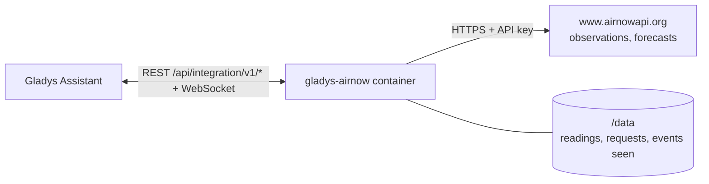
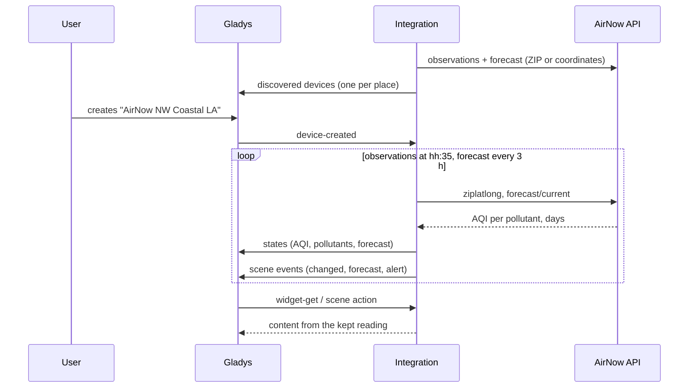
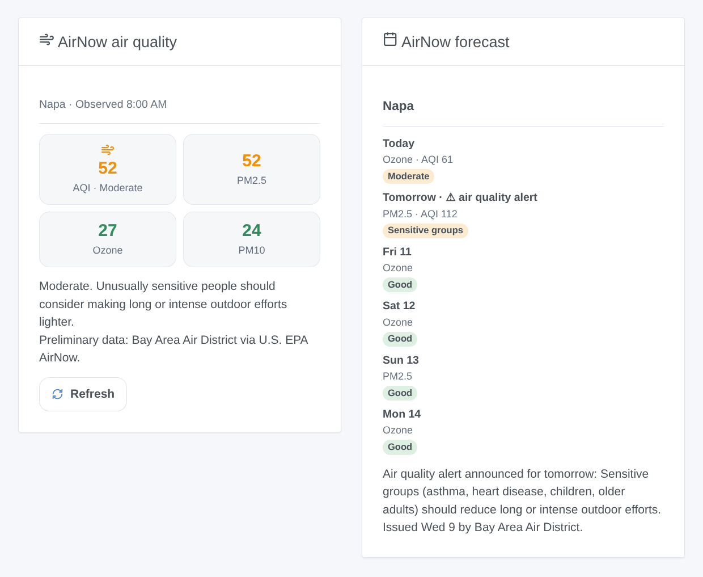

# Gladys AirNow

**English** · [Français](README.fr.md) · [Deutsch](README.de.md) · [Español](README.es.md)

[](LICENSE)
[](https://github.com/William-De71/gladys-airnow/releases)
[](https://github.com/William-De71/gladys-airnow/actions/workflows/release.yml)
[](https://gladysassistant.com)


[Gladys Assistant](https://gladysassistant.com) external integration for **[AirNow](https://www.airnow.gov)**, the air quality program of the U.S. EPA: the Air Quality Index now and its forecast for your places, scenes when the air quality changes or an alert is announced, and dashboard widgets. It reads the AirNow API with a free key.

## Features

- **One device per place** (up to three, a house of Gladys or a U.S. ZIP code), named after its reporting area: the AQI now, the AQI of PM2.5, ozone and PM10, the category, the forecast AQI of today and tomorrow, the forecast as text.
- **3 scene triggers**, **1 scene action** and **2 dashboard widgets** (below).
- The 2026 services of the AirNow API (the former ones were retired on 2026-09-30); United States, Canada and Mexico.
- Observations read at 35 minutes past every hour, forecasts every 3 hours, kept in `/data`; fewer than two requests per place and per hour.
- Configuration buttons: read now, diagnostic.
- Four languages everywhere: English, French, German, Spanish.

## How it works




For each place, the integration asks `/aq/observation/current/ziplatlong/` (one row per pollutant measured near the place: its NowCast AQI, its category, the reporting area, the monitor, the hour) and `/aq/forecast/current/` (one row per pollutant and per day: AQI or category only, action day, discussion), with the ZIP code or the coordinates of the house. The overall AQI is the highest of the pollutants, as AirNow shows it. Each reading is compared with the previous one to fire the scene triggers.



### Transport

Cloud only (`"transports": ["cloud"]`): the catalog shows the cloud badge. The integration contacts `www.airnowapi.org` over HTTPS with your key and, per place, the ZIP code or the coordinates of the house (rounded to about 10 m). There is no local alternative, so there is no "prefer the local connection" button.

## Devices and features

| Feature                              | Category / type         | Note                             |
| ------------------------------------ | ----------------------- | -------------------------------- |
| Air Quality Index                    | `airquality-sensor/aqi` | highest of the pollutants, 0-999 |
| PM2.5 (AQI), Ozone (AQI), PM10 (AQI) | `airquality-sensor/aqi` | NowCast of each pollutant        |
| Air quality                          | `text/text`             | the category                     |
| Forecast AQI today / tomorrow        | `airquality-sensor/aqi` | when the agency gives a number   |
| Forecast                             | `text/text`             | "Tomorrow: Moderate (Ozone)"     |

One device per place, `should_poll: false`. A value AirNow did not give is not published: no 0 is invented.

## Scene triggers, actions and widgets



**Triggers**

- **Air quality changed**: the category now changes. Filters: place, new category, direction (worse, better).
- **Forecast updated**: the forecast category of a day appears or changes. Filters: place, day, category.
- **Air quality alert**: a forecast announces an Air Quality Action Day. Filters: place, day.

**Action**: read the air quality of a place (AQI, category, forecast of today and tomorrow, alert, `summary` sentence).

**Widgets**: **AirNow air quality** (AQI and pollutants now, health message, agency) and **AirNow forecast** (one card per day, forecaster's discussion, alerts).

**Examples**

- When **the air quality becomes Unhealthy for sensitive groups or worse** → close the windows, turn the air purifier on.
- When **an alert is announced for tomorrow** → send a message to your phone.
- Every morning at 7:00 → **read the air quality** and have the `summary` spoken.

## Requirements

- Gladys Assistant **5.2.0** or later (the house picker). Older instances cannot install the integration.
- A free AirNow API key: [request an account](https://docs.airnowapi.org/account/request/), then copy the key shown at the top right of the Web Services page (see [docs/en.md](docs/en.md#get-an-api-key)).
- Places in the United States, Canada or Mexico.

## Installation

- **From the store** of Gladys (Integrations → External integrations), in one click, once indexed.
- **From the repository URL**: `https://github.com/William-De71/gladys-airnow`.
- **Developer mode**: build the image locally (`docker build -t gladys-airnow .`) and install it from Gladys.

## Configuration

| Field                 | Default   | Role                                               |
| --------------------- | --------- | -------------------------------------------------- |
| API key               | —         | The key of your AirNow account (secret).           |
| House (place 1-3)     | —         | A house of Gladys: its location locates the place. |
| Or a ZIP code         | —         | A U.S. ZIP code, five digits; wins over the house. |
| Language of the texts | automatic | Device names and scene texts.                      |

## Usage

1. Enter your API key and one to three places (a house or a ZIP code), then save.
2. Press **Read now** to check the key and see the AQI of each place.
3. In the **Discover** tab, create the "AirNow …" devices.
4. Add the **AirNow air quality** and **AirNow forecast** widgets to a dashboard, and build scenes with the triggers above.

## Development

```bash
npm install
npm test                       # node --test, never touches the network
npm run lint && npm run format:check
npx github:GladysAssistant/integration-store . --skip-image-check
scripts/build-cover.sh         # cover.jpg from docs/assets/cover.svg
docs/illustrations/render.sh   # docs/assets/widgets.<lang>.png
node .github/scripts/release.mjs next
```

Locally, the SDK reads `GLADYS_HOST_API_URL`, `GLADYS_INTEGRATION_TOKEN` and `GLADYS_INTEGRATION_SELECTOR`; `DEBUG=gladys-integration-sdk` shows the SDK logs and checks every widget content. The tests serve real answers of the 2026 AirNow services (`test/fixtures/`, captured by the authors of the R package [airnow](https://github.com/briandconnelly/airnow), MIT). The rules of the project are in [CLAUDE.md](CLAUDE.md).

## Release process


Every merge on `main` runs the CI, then computes the version from the [Conventional Commits](https://www.conventionalcommits.org/) since the last tag: `feat` → minor, `fix` / `perf` → patch, `!` or `BREAKING CHANGE` → major (a minor below 1.0.0); `docs`, `chore`, `ci`, `test`, `style`, `refactor`, `build` alone publish nothing. The changelog section is generated, the tag pushed, the multi-architecture image built, then `main` receives the release commit, the GitHub Release is created and a last job checks the public image, the store validator and the topic.

- The pull request title becomes the squash commit, then the changelog line: write it in English, for the user (`pr-title.yml` checks it). Never edit `CHANGELOG.md` by hand.
- 1.0.0 is a decision: Actions → Release → Run workflow with `release-as: 1.0.0`. `dry-run` shows the version and the notes without publishing.
- **Protected branch**: the release pushes its commit to `main` with `GITHUB_TOKEN`. With a ruleset on `main`, add GitHub Actions to its bypass list (or push through a GitHub App), otherwise the publish job fails with instructions.
- After the first release, make the `ghcr.io` package public (Package settings → Change visibility), or Gladys cannot pull it.

## Troubleshooting

See [docs/en.md](docs/en.md#troubleshooting). Report issues with the versions of Gladys and of the integration, the place, and the lines of the **Diagnostic** button.

## Contributing

Issues and pull requests are welcome. Run `npm run format:check && npm run lint && npm test` before opening a pull request, and keep every external id and stored key unchanged (see [CLAUDE.md](CLAUDE.md)).

## Security

See [SECURITY.md](SECURITY.md): report vulnerabilities privately. The API key is a `secret` field of Gladys, sent only to `www.airnowapi.org` over HTTPS and never written to the logs; the integration runs read-only, as a non-root user, in its container.

## Screenshots to come

The images above are illustrations, not screenshots. Real screenshots will go in `docs/assets/screenshots/` (PNG, 1280 × 800): `configuration.png`, `discovery.png`, `device.png`, `scene.png`.

## License

[Apache License 2.0](LICENSE) — see also [NOTICE](NOTICE). The air quality data come from the U.S. EPA AirNow program and its state, local and tribal partner agencies, which own them; they are preliminary and shown as received, with their agency. This integration is not affiliated with the EPA. Thanks to the Gladys documentation and SDK, to AirNow, and to the authors of the R package airnow for documenting the 2026 services.
